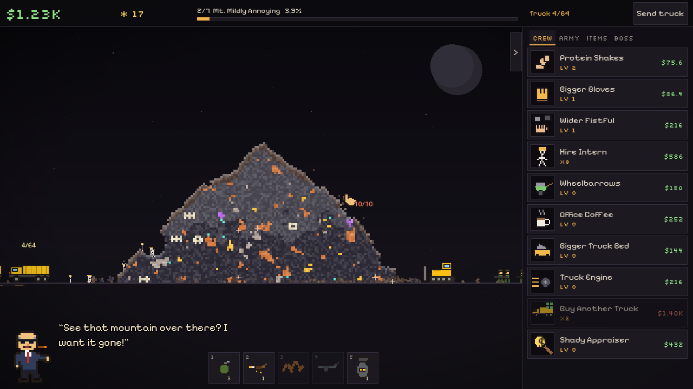

# Mountain Movers

> "See that mountain over there? I want it gone!" — your boss

A silly pixel-art clicker / idle game about removing a mountain one fistful at a time.
Built in **Godot 4** (GDScript), aimed at an eventual Steam release.



## Run it

**Just play (Windows):** grab `MountainMovers.exe` from the latest build and double-click it. Windows may say "Windows protected your PC" because the game isn't signed yet: click **More info → Run anyway**.

**From source:**

1. Install [Godot 4.3+](https://godotengine.org/download) (standard build, not .NET).
2. Open Godot, click **Import**, pick this folder's `project.godot`.
3. Press **F5** (or the ▶ Play button).

**Export your own .exe:** in Godot, *Editor → Manage Export Templates → Download*, then *Project → Export → Windows Desktop → Export Project*. The preset is already set up (single .exe, everything embedded).

## How to play

The boss wants the mountain gone. You get paid by the truckload.

| Input | What it does |
| --- | --- |
| Left click the mountain | Break off rock into your hand (hold to keep digging) |
| Drag to the truck and let go | Load it into the truck |
| Drag and fling | Throw it (rocks that land in the truck bed get loaded) |
| Left click a loose rock | Pick it up |
| Right click | Drop what you're holding |
| 1-5, then click | Use a one-use item (grenade, large bird, earthquake, airstrike, nuke) |
| WASD / arrows / right-drag | Move the camera |
| Mouse wheel | Zoom |
| F | Re-centre on the mountain |
| Esc | Cancel an item |
| Tab (or the arrow tab) | Hide / show the shop panel |

- **Dump trucks** are the only income. A truck parks at the loading spot; when it's full it honks, drives off, sells the load and comes back. Ore makes rock worth more, and buried **fossils and artefacts** (Ancient Toaster, Cursed Spork, ...) pop out as glowing finds worth a lot. **Send truck** sends a half-full one.
- **Crew** tab: stronger hands, bigger gloves, wider fistful, **interns** (stick people who dig and haul rock to the truck on their own), wheelbarrows, coffee, bigger truck beds, faster trucks, more trucks, appraiser.
- **Military** tab: soldiers, machine gunners, a .50 BMG pickup, tanks and bulldozers, set up on the far side of the mountain. Plus weapon upgrades. They knock rock loose; somebody still has to haul it.
- **Items** tab: buy one-use items for the hotbar.
- **Clear a mountain** and the boss pays **Boss Approval**. Then a bigger, tougher mountain grows back and your cash, crew, army and trucks reset.
- **Boss** tab: spend approval on permanent perks, or regrow the current mountain early for partial approval. Volume slider lives here too.
- **7 mountains.** Move the 7th (Mt. Everything) and the boss is finally happy. You win.

Progress autosaves every 15 seconds and on quit.

### Debug cheats (editor / debug builds only)

| Key | Cheat |
| --- | --- |
| F9 | + cash |
| F10 | + 25 Boss Approval |
| F11 | Instantly clear the current mountain |

## Project layout

```
project.godot
export_presets.cfg          Windows / Linux export presets
scenes/main.tscn            Main scene (just a root node, everything is built in main.gd)
scripts/
  game_state.gd             Autoload "Game": money, upgrades, prestige, save/load, stat formulas
  sfx.gd                    Autoload "Sfx": plays assets/sounds/*.wav
  main.gd                   Input, hand, mountain-cleared flow, autosave, wiring
  mountain.gd               The destructible pixel mountain (generation, damage, rendering)
  rock.gd / rock_manager.gd Loose physics rocks (spawn, merge, pick up, save)
  hand.gd                   What you're holding
  truck_depot.gd            Dump truck fleet: loading, driving off, selling
  interns.gd                Stick-figure interns (dig + haul AI)
  military.gd               Soldiers, gunners, .50 BMG pickup, tanks, bulldozers
  abilities.gd              One-use items
  camera_rig.gd             Pan / zoom camera
  effects.gd                Debris, tracers, explosions, smoke
  boss.gd                   The boss and his speech bubble
  sky.gd / background.gd    Placeholder sky and ground
  ui/hud.gd                 Top bar, collapsible shop panel, hotbar, popups
  ui/theme_builder.gd       Dark UI theme (colours, fonts, styles)
  data/materials.gd         Mountain materials, values, fossil/artefact shapes
  data/upgrades.gd          Upgrades, military, items, perks: names, descriptions, prices
  data/quips.gd             Everything the boss says
assets/sprites/             Placeholder art
assets/sounds/              Placeholder sound effects
tools/gen_placeholder_art.py  Regenerates the placeholder sprites (needs Pillow)
tools/gen_placeholder_sfx.py  Regenerates the placeholder sounds (standard library only)
tools/gen_icons.py          Regenerates the upgrade icons (needs Pillow)
tests/smoke_test.tscn       Headless test: hand, trucks, interns, military, items, all 7 mountains
```

## Swapping in real art and sound

Overwrite any file in `assets/sprites/` or `assets/sounds/` with one of the same name and the game uses it.

| Sprite | Used for | Drawn at |
| --- | --- | --- |
| `boss.png` | The boss (20×24) | 4× |
| `truck.png` | Dump truck (48×25, bed is x 16-47) | 2× |
| `soldier.png`, `gunner.png` | Troops (14×16) | 2× |
| `technical.png`, `tank.png`, `bulldozer.png` | Vehicles | 2× |
| `bird.png` | Large bird | 3× |
| `grenade.png`, `nuke.png`, `quake.png`, `airstrike.png` | Items and hotbar icons | 2-3× |
| `cursor_hand.png` | Your hand | 1× |
| `icon.png` | Window / app icon | — |

Upgrade icons live in `assets/icons/<upgrade id>.png` (16×16 placeholders from `tools/gen_icons.py`; any size works). Fonts are Silkscreen and Pixelify Sans (`assets/fonts/`, SIL Open Font License). UI colours are in `scripts/ui/theme_builder.gd`.

Interns are drawn in code (`interns.gd`, `_draw`) as stick figures. Mountain pixel colours live in `scripts/data/materials.gd`.

Sounds: `dig`, `crumble`, `grab`, `drop`, `thud`, `horn`, `engine`, `cash`, `explosion`, `grenade`, `nuke`, `rumble`, `rifle`, `mg`, `bmg`, `cannon`, `scrape`, `bird`, `buy`, `find`, `deny`, `boss`, `blip`, `tick`, `clear` (all `.wav`; `.ogg` works too if you change the extension check in `sfx.gd`).

## Balancing

Prices and growth rates are in `scripts/data/upgrades.gd`. Stat formulas (damage, interns, trucks, military, how much tougher each mountain is, approval payouts) are in the "derived stats" and "prestige" sections of `scripts/game_state.gd`. Mountain sizes are in `Game.MOUNTAINS`. Military fire rates and damage are in `Military.UNITS`.

The numbers are a first pass, not tuned yet.

## Running the smoke test

```
godot --headless --path . res://tests/smoke_test.tscn
```

Exits with code 0 when everything passes. It wipes your local save.

## Steam later

Nothing Steam-specific is wired in yet. When it's time: add [GodotSteam](https://godotsteam.com/) for achievements/cloud saves, and add a macOS export preset if needed.
