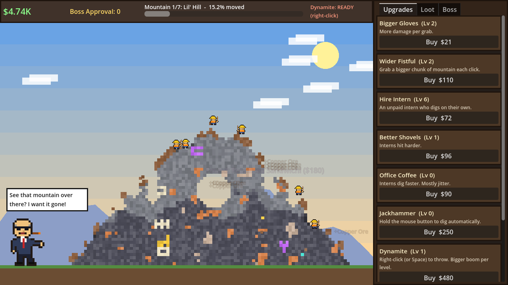

# Mountain Movers

> "See that mountain over there? I want it gone!" — your boss

A silly pixel-art clicker / idle game about removing a mountain one fistful at a time.
Built in **Godot 4** (GDScript), aimed at an eventual Steam release.



## Run it

1. Install [Godot 4.3+](https://godotengine.org/download) (standard build, not .NET).
2. Open Godot, click **Import**, pick this folder's `project.godot`.
3. Press **F5** (or the ▶ Play button).

The first open takes a few seconds while Godot imports the sprites.

## How to play

| Input | What it does |
| --- | --- |
| Left click | Grab rock. Starts at one pixel per click. |
| Hold left click | Jackhammer (after you buy it) |
| Right click / Space | Throw dynamite (after you buy it) |

- **Rubble** (dirt, stone, hard rock) pays a tiny disposal fee instantly.
- **Ore** (copper, iron, gold, gems) goes into your loot bag. Sell it in the **Loot** tab.
- **Fossils and artefacts** are multi-pixel finds buried in the mountain. Dig out every pixel to collect the whole thing (Ancient Toaster, Cursed Spork, ...).
- **Upgrades** tab: gloves, wider fistful, interns (they dig on their own, the idle part), shovels, coffee, jackhammer, dynamite, appraiser, auto-seller.
- **Clear a mountain** and the boss pays you **Boss Approval**. Then a bigger, tougher mountain grows back and your cash and run upgrades reset.
- **Boss** tab: spend approval on permanent perks (gym, intern union, seed funding, geology degree, lucky hard hat, headhunter, explosives license). You can also *regrow* the current mountain early for partial approval if you're stuck.
- **7 mountains.** Move the 7th (Mt. Everything) and the boss is finally happy. You win.

Progress autosaves every 15 seconds and on quit.

### Debug cheats (editor / debug builds only)

| Key | Cheat |
| --- | --- |
| F9 | + cash |
| F10 | + 25 Boss Approval |
| F11 | Instantly clear the current mountain |

## Project layout

```
project.godot
scenes/main.tscn            Main scene (just a root node, everything is built in main.gd)
scripts/
  game_state.gd             Autoload "Game": money, upgrades, prestige, save/load, stat formulas
  main.gd                   Input, dynamite, effects, mountain-cleared flow, autosave
  mountain.gd               The destructible pixel mountain (generation, damage, rendering)
  worker_crew.gd            Interns that dig automatically
  boss.gd                   The boss sprite and speech bubble
  debris.gd                 Pixel particles
  background.gd             Placeholder sky/hills/ground
  ui/hud.gd                 Top bar, Upgrades/Loot/Boss tabs, popups
  data/materials.gd         Mountain materials, ore values, fossil/artefact shapes
  data/upgrades.gd          Upgrade names, descriptions, prices
  data/quips.gd             Everything the boss says
assets/sprites/             Placeholder art (boss, worker, dynamite, cursor, icon)
tools/gen_placeholder_art.py  Regenerates the placeholder sprites (needs Pillow)
tests/smoke_test.tscn       Headless test that plays through all 7 mountains
```

## Swapping in real art

All placeholder art is in `assets/sprites/`. Overwrite a PNG with the same file name and it's used automatically:

| File | Used for | Drawn at |
| --- | --- | --- |
| `boss.png` | The boss (20×24) | 5× scale |
| `worker.png` | Interns (12×12) | 2× scale |
| `dynamite.png` | Thrown dynamite (6×11) | 3× scale |
| `cursor_hand.png` | Mouse cursor | 1× |
| `icon.png` | Window / app icon | — |

If new sprites are a different size, adjust the scale in `boss.gd`, `worker_crew.gd` or `main.gd`.
Mountain pixel colours live in `scripts/data/materials.gd`, and the sky/ground are drawn in `background.gd` (easy to replace with a background image later).

## Balancing

Prices and growth rates are in `scripts/data/upgrades.gd`. Stat formulas (damage, interns, dynamite, how much tougher each mountain is, approval payouts) are in the "derived stats" and "prestige" sections of `scripts/game_state.gd`. Mountain sizes are in `Game.MOUNTAINS`.

The numbers are a first pass, not tuned yet.

## Running the smoke test

```
godot --headless --path . res://tests/smoke_test.tscn
```

Exits with code 0 when everything passes. It wipes your local save.

## Steam later

Nothing Steam-specific is wired in yet. When it's time: add [GodotSteam](https://godotsteam.com/) for achievements/cloud saves, and set up export presets for Windows/macOS/Linux in **Project → Export**.
